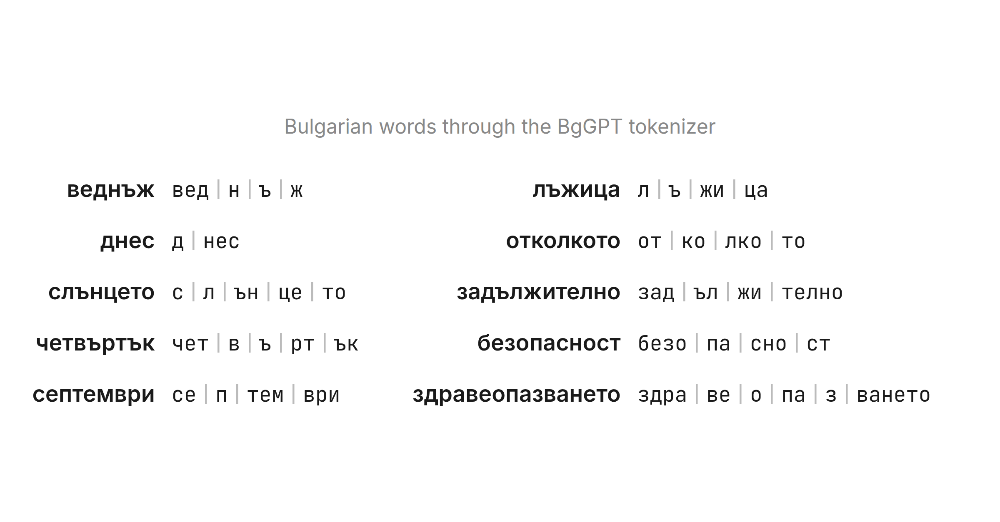

# BgVoc - A Bulgarian Tokenizer for BgGPT

I'm a big fan of the [BgGPT models](https://huggingface.co/collections/INSAIT-Institute/bggpt-gemma-3-69be9285046cd4daeb6c536d). INSAIT did a great job of teaching Gemma Bulgarian, and the models are among the best open options for our language. But one part of them is still generic: the tokenizer. BgGPT reuses the Gemma tokenizer, which was built for many languages at once.

In the Gemma tokenizer, only **5%** of tokens are from Cyrillic characters. This leads to poor tokenization for Bulgarian words:

The splits ignore Bulgarian morphology: roots are torn apart (`зад-ъл-жи-телно`), and single letters end up as tokens of their own. The letter **ъ** suffers the most. It is common in Bulgarian, but rare in the other Cyrillic languages, so the tokenizer learned few merges that contain it.

Not only that, but this means that Bulgarian texts get longer sequences which makes it more computationally expensive (and slower) to generate text. Measured on the [finepdfs](https://huggingface.co/datasets/HuggingFaceFW/finepdfs) test splits, the tokenizer achieves 2.32 tokens per word for Bulgarian versus 1.66 for English. This means that **Bulgarian texts are 40% longer in tokens**.

So, I have decided to build **BgVoc**: an extension of BgGPT which processes Bulgarian text more efficiently and intelligently without losing math, coding, English or other capabilities. 

We will achieve this by applying transfer learning strategies on the BgGPT models and a new Bulgarian vocabulary. This idea is not new. In fact, our approach will be quite similar to [VocADT](https://arxiv.org/abs/2410.09644). There is also an aptly named library called [tokensurgeon](https://github.com/arcee-ai/mergekit/blob/main/docs/tokensurgeon.md). I especially like the name as the techniques we apply need to conduct very careful operations on the input and output embeddings.

## The series 

The series will consist of the following posts:

1. This post: why the tokenizer matters
1. Audit of the BgGPT tokenizer
2. Training a new Bulgarian tokenizer
3. Baselines using the tokensurgeon library 
4. VocADT finetuning
5. Results and ablations

---

In the next post I audit the BgGPT tokenizer in full. Spoiler: 99% of the tokens in Bulgarian text come from just 8,306 of the 262k tokens in the vocabulary. [Follow me on LinkedIn](https://www.linkedin.com/in/martin-boyanov-1ab2124a/) to get the next part (when it comes out).